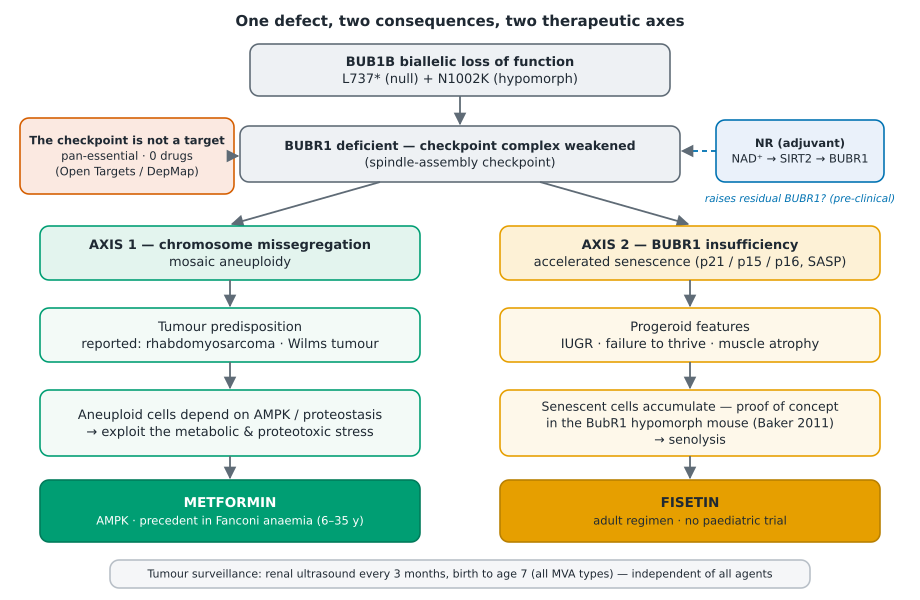
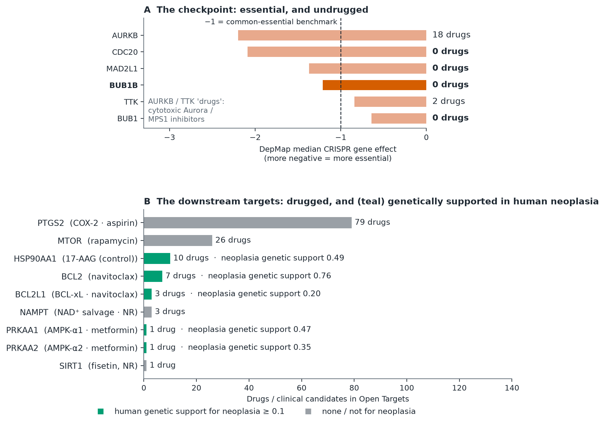
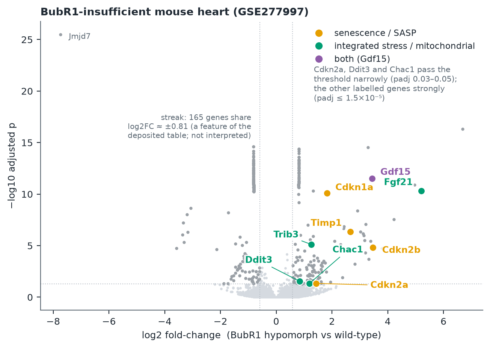

# Track 2 — Drug Repurposing Report
### Rare Disease, Real Kid: MVA Hackathon 2026 · Proband `PROBAND01`

> **Read this first.** This is a research hypothesis prepared for a hackathon. It is **not medical
> advice and not a treatment recommendation.** Every agent discussed would be off-label for this
> child, and any decision belongs to the child's clinical team and family. Nothing here uses
> information beyond what the challenge provided.

---

## 1. Summary — the proposal

`PROBAND01` has **mosaic variegated aneuploidy syndrome type 1 (MVA1)** caused by **biallelic loss
of function of `BUB1B`** — compound heterozygous `c.2210T>G` p.(Leu737Ter) and `c.3006T>G`
p.(Asn1002Lys), identified in Track 1 and since confirmed by five independent lines of evidence. `BUB1B` encodes **BUBR1**, the pseudokinase that keeps the **mitotic spindle-assembly
checkpoint (SAC)** closed until every chromosome is correctly attached. A hypomorphic BUBR1
produces **two consequences from the same defect**, and each opens a separate therapeutic angle:

| Consequence of low BUBR1 | Phenotype in the record | Therapeutic axis |
|---|---|---|
| Chromosome missegregation → constitutional mosaic aneuploidy | rhabdomyosarcoma on the phenotype list; childhood cancers reported in BUB1B-related MVA include embryonal rhabdomyosarcoma and Wilms tumour — risk clearly increased but not quantifiable | exploit the **metabolic / proteotoxic vulnerability of aneuploid cells** |
| BUBR1 insufficiency → accelerated cellular senescence | severe IUGR and prematurity, failure to thrive, skeletal-muscle atrophy, nephrocalcinosis | **clear accumulating senescent cells** (senolysis) |

**The disease gene is not a drug target.** `BUB1B` is pan-essential (DepMap CRISPR gene effect
median −1.21), has **zero drugs or clinical candidates** in Open Targets, and the only compounds
near it in the interactome are spindle poisons and cytotoxic chemotherapy — which would weaken an
already weak checkpoint. The opportunity is **downstream** (§3).

**Proposed agents — ordered by the strength of the clinical evidence in children** (the mechanistic
rationale is strong for all three):

| # | Agent | Role | Dose and its source | Evidence in children | Confidence |
|---|---|---|---|---|---|
| 1 | **Metformin** | AMPK activation → metabolic stress that aneuploid cells tolerate poorly | start 500 mg/day, +500 mg/day to 500 mg b.i.d. (<10 y) or 1000 mg b.i.d. (≥10 y) — protocol of NCT03398824 | Fanconi anaemia (a paediatric genome-instability syndrome), 6–35 y, median 9.4 y, 14 treated: no metabolic acidosis, no grade ≥3 events, haematological response 4/13 | **highest** |
| 2 | **Nicotinamide riboside (NR)** | NAD⁺ → SIRT2 → BUBR1: upstream adjuvant that could raise residual BUBR1 | 25 mg/kg/day — ataxia-telangiectasia study | ataxia-telangiectasia, 24 patients (17 children), 4 months: tolerated well; improved ataxia scores and IgG. **None in cancer predisposition** | moderate (safe; the MVA mechanism is pre-clinical) |
| 3 | **Fisetin** | senolytic — the progeroid axis | 20 mg/kg/day × 2 consecutive days, every 4 weeks — an **adult** regimen, extrapolated by weight | **none.** Adult trials only (SEN-SURVIVORS ≥18 y; older adults ≥60 y) | lowest clinically; strongest mechanistic fit to the progeroid axis |

**Regulatory status:** metformin is an approved medicine. NR and fisetin are marketed as dietary
supplements, not approved medicines; any use needs a pharmaceutical-grade source and clinical
supervision (§9).

**Context, not repurposing:** intensive tumour surveillance (renal ultrasound every 3 months from birth
to age 7, as recommended for all MVA types) is the highest-impact recommended intervention and is independent of
everything above. Low-dose aspirin ± resveratrol are an optional low-evidence adjunct (adult
evidence only; Reye-syndrome precautions).

**What this is:** a mechanistically grounded hypothesis, cross-checked by eleven lines of evidence,
for an n-of-1 discussion between clinical genetics and paediatric oncology. There has never been an
interventional trial in MVA1 (§7). It is **not** a proven treatment (§9).

**What is new here:** (i) the *two-axes-from-one-defect* framing, anchored in the BubR1-hypomorphic
mouse in which clearing senescent cells was first shown to delay age-related disease; (ii) a **druggability gate** showing the checkpoint is
intractable, which moves the search downstream; (iii) an **evidence ladder** that keeps mechanistic
plausibility separate from paediatric clinical evidence; (iv) a proposed **n-of-1 monitoring frame**
with pharmacodynamic biomarkers read off primary transcriptome data (§8); (v) everything
reproducible from public data on a dual-core laptop (§10–11).

---

## 2. The variant and the broken pathway

### 2.1 The two alleles

| | Allele A | Allele B |
|---|---|---|
| GRCh38 | chr15:40,209,701 T>G | chr15:40,220,612 T>G |
| HGVS (NM_001211.6) | c.2210T>G p.(Leu737Ter) | c.3006T>G p.(Asn1002Lys) |
| Effect | nonsense, exon 17/23 → truncation (null) | missense, exon 23/23, C-terminal pseudokinase domain |
| Evidence | ClinVar Pathogenic (VCV000533901); gnomAD 7.9×10⁻⁵ | absent from gnomAD; SIFT 0.01, PolyPhen-2 0.997, AlphaMissense 0.923, CADD 24.5 |

Both calls are supported by five independent lines: the consortium GATK VCF plus four analyses of
the raw reads (read counting after k-mer extraction; bwa-mem + bcftools; bwa-mem + Clair3 targeted;
bwa-mem + Clair3 whole-genome). Three genome-wide scans (ClinVar on the provided VCF; a novel-variant
scan of a 235-gene panel; ClinVar on our independent callset) find **no other gene with two rare
deleterious alleles**. The *phase* of the two alleles (trans) is not proven — there is no parental
data (Track 1 caveat).

### 2.2 A null plus a hypomorph

BUBR1 is a component of the **mitotic checkpoint complex** (BUBR1–BUB3–MAD2–CDC20), which inhibits
the anaphase-promoting complex until all kinetochores are attached. The two alleles are different
in kind. **A** truncates the protein. **B** replaces Asn1002 — which, in the AlphaFold model of
BUBR1 (pLDDT 91 at this position), is **buried in the hydrophobic core of the pseudokinase C-lobe**
(161 heavy atoms within 10 Å of its Cα, flanked by Trp973/Trp978 and Phe954/977/996/997) and is ~19 Å
from the HRD-like (HGD 880–882) and ~27 Å from the DFG-like (DFS 911–913) motifs, i.e. *not* in the
(pseudo)active site (`investigacion/estructura/n1002_structure.py`). An
Asn→Lys change puts a charge in a hydrophobic core: a **folding defect, not a catalytic one** —
a **hypomorph**. That is the allele pair expected in MVA1: complete loss of BubR1 is
embryonic-lethal in mice (Kim et al. 2005), so a viable patient is expected to carry at least one
hypomorphic allele.

### 2.3 Two consequences, two axes

1. **Weak checkpoint → missegregation → mosaic aneuploidy → tumour predisposition.** The cellular
   hallmark of BUB1B-related MVA is premature chromatid separation. Cancer risk is clearly increased,
   but the rarity of the syndrome prevents an accurate estimate (Nakano et al. 2024); the reported
   tumours are childhood cancers, including embryonal rhabdomyosarcoma (Hanks et al. 2004) and
   bilateral Wilms tumour (Ochiai et al. 2019).
2. **BUBR1 insufficiency → senescence → progeroid features.** Mice with low BubR1 levels develop
   progressive aneuploidy and progeroid features (Baker et al. 2004); p16Ink4a-positive senescent cells accumulate and drive progeroid pathology — including
   sarcopenia — and their genetic clearance delays it (Baker et al., *Nature* 2011). That experiment —
   the first to show that removing senescent cells delays age-related disease — was done in a BubR1
   hypomorph.

---

## 3. Why repurposing — and why downstream

**No cause-directed therapy exists.** Management is symptomatic: tumour surveillance, standard
protocol treatment of any tumour (genome-instability disorders as a group can be unusually sensitive
to radiation and chemotherapy; Nakano et al. 2024), and developmental support.

### 3.1 The checkpoint is not a drug target (C10)

| Gene | Open Targets "essential" flag (DepMap median gene effect) | Drugs / clinical candidates in Open Targets |
|---|---|---|
| **BUB1B** | **yes (−1.21)** | **0** |
| BUB1 | yes (−0.64) | 0 |
| MAD2L1 | yes (−1.37) | 0 |
| CDC20 | yes (−2.09) | 0 |
| TTK (MPS1) | yes (−0.84) | 2 |
| AURKB | yes (−2.20) | 18 — cytotoxic Aurora inhibitors |

A median gene effect near or below −1 (the usual common-essential benchmark) means most cell lines
need the gene: `BUB1B`, `MAD2L1`, `CDC20` and `AURKB` are past it; `BUB1` and `TTK` are flagged
essential but less uniformly. Inhibiting the checkpoint is therefore cytotoxic chemotherapy, not targeted therapy — and, in a child whose
checkpoint is already weak, the wrong direction. Two network-proximity analyses agree (C1 shortest
path; C5 random walk on STRING ≥700 and ≥900, Spearman ρ −0.58 to −0.67 between them — the sign
reflects distance versus proximity): the compounds nearest `BUB1B`/the SAC are Aurora/PLK/MPS1
inhibitors, taxanes, vinca alkaloids and antimetabolites.

### 3.2 The biology around the gene contains both axes (C6)

The 187-gene STRING neighbourhood of `BUB1B` is, as expected, the checkpoint (Reactome "Cell
Cycle" adjusted p = 2.5×10⁻¹²¹; "Mitotic Spindle Checkpoint" 3.4×10⁻¹¹⁹). The same module is also
enriched for **"Cellular Senescence" (p = 3.7×10⁻²⁶), "SASP" (1.2×10⁻²⁰)** and "Oxidative Stress
Induced Senescence" (7.9×10⁻⁸), and 37 of its 187 genes belong to **CIN70**, the clinical
chromosomal-instability signature (`BUB1B` itself does not). The enrichment was run on the
interactome without assuming either axis.

### 3.3 Primary transcriptome data show both axes (C4)

In GEO GSE277997 (BubR1-insufficient mouse heart; 168 genes up and 160 down at padj below 0.05 and
|log2FC| above 0.585), the induced genes include the senescence markers **Cdkn1a (p21), Cdkn2b (p15), Timp1** and
**Gdf15**, and the integrated-stress / mitochondrial-stress genes **Fgf21, Trib3** and Gdf15 — all at
padj ≤ 1.5×10⁻⁵ (Gdf15 log2FC 3.4, Fgf21 5.2) — the integrated-stress response characteristic of
aneuploid cells (the signature used in C3). **Cdkn2a (p16), Ddit3 (CHOP) and Chac1 pass the
threshold only narrowly (padj 0.03–0.05).** A second dataset (GSE134781, Sieben et al. 2020; heterozygous *carrier* skeletal muscle of
knock-ins that mimic patient alleles L1012P — mouse numbering L1002P, about ten residues from the
proband's N1002K — and a truncating X753) does **not** reproduce the signature (agreement at chance level), as expected for
asymptomatic carriers in a different tissue; it is used only as context. The deposited table also
contains a streak of 165 genes with an almost identical fold-change (log2FC ≈ ±0.81; the vertical
columns in Figure 3) — a feature of the table that is not interpreted; the signature-reversal
analysis was therefore repeated without them (§4, C4).

---

## 4. Methods — eleven lines of evidence

Candidate agents were triaged by a curated mechanistic analysis plus ten computational or
data-driven analyses (C1–C10). The scripts, outputs and data versions are in the repository
(§11).

| ID | Question | Data and method | Result |
|---|---|---|---|
| Curated | what do mechanism and literature support? | manual curation over a PubMed / ClinicalTrials.gov evidence pipeline | two axes; senolytics, metformin/AICAR, NAD⁺ precursors; resveratrol + aspirin |
| **C1** | which of 8,706 drugs have targets near each disease module? | STRING v12 ≥700 (15,882 genes, 236,712 edges); closest-distance (Guney 2016); z versus 1,000 degree-matched sets; four modules | gene module: spindle/PLK/MPS1 inhibitors and antimetabolites; senescence module: BCL-2/xL (navitoclax z −2.2); aneuploidy-stress module: AICAR −5.7, aspirin −6.0, 17-AAG −4.2, rapamycin −4.0, metformin −3.7 |
| **C2** | what does full-text literature co-mention with BUB1B/aneuploidy/senescence? | Europe PMC, 25 queries, 220 open-access full texts, 6,578-compound lexicon | raw ranking dominated by reagents and chemotherapy; after filtering the curated set re-emerges; two cautions added (TKIs and clonal chromosomal abnormalities; flavonoid combinations) |
| **C3** | which perturbagens reverse literature-defined signatures? | L1000CDS2; senescence, aneuploidy-response and CIN70 signatures | HSP90, CDK and mTOR inhibitors reverse the signatures; dasatinib reverses senescence |
| **C4** | …a signature derived from primary BubR1-insufficiency data? | GEO GSE277997 → L1000CDS2 | signature shows both axes (§3.3); reversing mechanism classes (HSP90, mTOR, HDAC, CDK) match C3 and persist when 165 uniform-fold-change genes are excluded (top reverser: the mTORC1/2 inhibitor INK-128); scores low (tissue-level signature) |
| **C5** | does C1 survive another metric and network? | personalized PageRank; STRING ≥700 and ≥900 | same conclusion; senolytics ~3× closer to the senescence module than to the gene module (mean z 0.60 vs 0.19), mTOR/HSP90/AMPK agents ~2× (1.37 vs 0.64) |
| **C6** | what biology surrounds BUB1B? | 187-gene interactome module; Enrichr (GO, Reactome, Hallmark) | §3.2 |
| **C7** | is there clinical precedent? | ClinicalTrials.gov v2: 44 queries, 146 trials seen, 15 read in full with eligibility ages | none in MVA/PCS/BUB1B/CEP57; 5 of 15 include children (§7) |
| **C8** | can it be dosed for this child? | trial protocols, labels, PharmCAT v3.4.0 on the proband's variants | §5–6 |
| **C9** | safety signals? | openFDA FAERS (paediatric strata) | class events as expected; paediatric exposure exists for metformin (523 reports <18 y), sirolimus (672), aspirin (1,344) |
| **C10** | is the gene druggable; do the target genes have human genetic support? | Open Targets Platform v4; DepMap | §3.1 and §5 |

**What the convergence does and does not show.** The methods are independent in data and algorithm,
but **not in framing**: C1, C3 and C5 take the two axes as their disease modules. What they test
is whether the *drugs* picked by the curated analysis also emerge from unbiased searches of drug
space, and whether anything *else* does — nothing new, clean and approved did. The framing itself
is tested separately by C6 (interactome enrichment that assumes neither axis), C4 (primary
transcriptome data), C10 (druggability) and the primary literature.

---

## 5. The candidates

### 5.1 Metformin — best supported

*Mechanism.* AMPK activation. In the screen of Tang et al. (*Cell* 2011) the aneuploidy-selective
compounds were the energy-stress agent **AICAR** (an AMPK activator), the HSP90 inhibitor 17-AAG and
the autophagy inhibitor chloroquine; metformin is an indirect AMPK activator (extrapolation from
AICAR). C1: AICAR z −5.7, metformin −3.7. C10: **PRKAA1/PRKAA2
have human genetic support for neoplasia** (Open Targets genetic-association 0.47 gastric
carcinoma; 0.35 ovarian neoplasm — direction not indicated).

*Evidence.* NCT03398824 (Fanconi anaemia, Boston Children's; Pollard et al., *Blood Adv* 2022): 6–35 years, median
9.4, 14 treated for 6 months on immediate-release metformin dosed as for type 2 diabetes. Starting
dose 500 mg/day, increased by 500 mg/day to 500 mg b.i.d. (<10 y) or 1000 mg b.i.d. (≥10 y).
Haematological response 4/13 (31 %); **no metabolic acidosis, no hypoglycaemia, no grade ≥3 events
attributed to metformin**; diarrhoea in 12/14 (grade 1 in 9, grade 2 in 4); one dose reduction
(2000→1500 mg/day). The endpoint was haematological — **not** tumour prevention.

*This child.* OCT1 (SLC22A1) reduced-function variants R61C, G401S, M420del and G465R are all
reference → expected normal hepatic uptake. **Nephrocalcinosis → eGFR at baseline and periodically;
hold during dehydration, vomiting or iodinated contrast; B12 yearly.** Lactic acidosis is a rare,
labelled class risk tied mainly to renal impairment (it appears among FAERS reports); the Fanconi
trial saw none.

### 5.2 Nicotinamide riboside — safe adjunct

*Mechanism.* BUBR1 declines with age because NAD⁺ falls and SIRT2 can no longer keep BUBR1
lysine-668 deacetylated; overexpressing SIRT2 **or giving the NAD⁺ precursor NMN raises BUBR1 levels
in mice**, and SIRT2 overexpression extends median lifespan of BubR1-hypomorphic mice (North et
al. 2014). NAD⁺ repletion is the
most upstream intervention — it acts on the cause rather than the consequence — but the evidence
is mouse and cell data only, and whether a *destabilised* BUBR1 (N1002K) responds is unknown.

*Evidence.* Veenhuis et al. (*Mov Disord* 2021): open-label proof-of-concept study, 24 patients with
ataxia-telangiectasia (17 children), 25 mg/kg/day for 4 months — improved ataxia scores and IgG;
"tolerated well"; ataxia worsened again after withdrawal. Further registered trials: NCT04870866 (A-T, ≥3 y), NCT04192136 (Friedreich ataxia,
10–40 y). **No trial in cancer predisposition.** FAERS holds only 36 reports for NR in total; high-dose
*nicotinamide* (not NR) shows hepatic-enzyme signals and inhibits sirtuins — hence NR.

### 5.3 Fisetin — strongest mechanism, weakest paediatric evidence

*Mechanism.* Senolysis. The proof of concept is the BubR1 hypomorph itself (§2.3), whose muscle
sarcopenia matches the proband's atrophy, and C4 shows p21 and p15 induction (p16 only narrowly)
in BubR1-insufficient tissue.

*Evidence — adults only.* Dose from the Mayo "hit-and-run" trials: 20 mg/kg/day for two consecutive
days, repeated monthly. Registered trials: SEN-SURVIVORS (NCT04733534; fisetin or dasatinib +
quercetin; **adult survivors ≥18 y** of childhood cancer, n=120) and NCT04313634 (older adults ≥60
y). **No paediatric trial exists; the dose is an adult regimen extrapolated by weight, and
paediatric pharmacokinetics are unknown.** Oral bioavailability is low and variable.

*This child.* Fisetin is reported to inhibit CYP2C9 in vitro (and, like other flavonoids, UGTs and
transporters; clinical relevance unknown); the proband is CYP2C9 normal, so the concern is for
*co-medication* (celecoxib, ibuprofen, warfarin, methotrexate, irinotecan), not to the
child's own clearance. *Why not dasatinib + quercetin:* bone growth and development events occurred
in 4 % of children in the paediatric dasatinib trial (Gore et al. 2018); clonal chromosomal
abnormalities in Philadelphia-negative cells are a recognised phenomenon during TKI therapy (Wang
et al. 2013) — a poor fit for a child with constitutional chromosomal instability; and pleural effusion is the commonest
FAERS event for dasatinib. Whether clearing senescent cells helps when senescence is driven by BUBR1
insufficiency — rather than by age or chemotherapy — is untested.

### 5.4 Reserve, hypothesis-only and excluded

| Agent | Status | Reason |
|---|---|---|
| Dasatinib + quercetin | reserve | see §5.3; only if fisetin fails and paediatric oncology agrees |
| Navitoclax | reserve | on-target, dose-limiting thrombocytopenia from BCL-xL inhibition (Mahadevan et al. 2025); platelet-sparing BCL-xL degraders are a future alternative |
| Rapamycin / sirolimus | hypothesis | strong in C1/C3/C5 and in progeria (NCT02579044, 18 mo–25 y), but immunosuppressive in a child with tumour risk |
| 17-AAG / HSP90 inhibitors | **mechanistic validation only** | strongest computational signal (C1 z −4.2, reverses C3 signatures) but unapproved: 38 oncology trials, abandoned for toxicity |
| Aurora / PLK / MPS1 inhibitors | **contraindicated** | inhibit an already weak checkpoint |
| HDAC inhibitors | not repurposing | recurrent in C1/C2/C4; cytotoxic oncology agents |
| Aspirin ± resveratrol | optional context | chemoprevention evidence only in adults (Lynch syndrome); Reye syndrome — hold in febrile viral illness and peri-operatively |

---

## 6. Patient-specific considerations

PharmCAT v3.4.0 on the proband's variants (research mode, `--absent-to-ref`; the VCF is
variant-only). **Research-grade calls — a clinical decision would need a validated assay**
(CYP2D6 is SNV-only; OCT1 was checked by hand).

| Gene | Result | Implication |
|---|---|---|
| SLC22A1 (OCT1) | no reduced-function variants | metformin uptake expected normal |
| CYP2C9 | \*1/\*1 | fisetin affects co-medication, not this child's clearance |
| CYP3A4 / CYP3A5 | \*1/\*1 · \*3/\*3 | normal 3A4; non-expressor 3A5 |
| G6PD | normal | aspirin and rasburicase without haemolysis risk |
| DPYD, TPMT, NUDT15, UGT1A1 | normal | standard-dose chemotherapy backbone |
| CYP2D6 | \*4/\*35 (intermediate) | codeine / tramadol less effective — prefer morphine or hydromorphone |
| CYP2C19 | \*2/\*17 (intermediate) | voriconazole needs drug monitoring |
| **RYR1** | c.6178G>T (VUS) | malignant-hyperthermia susceptibility **uncertain** → prefer TIVA, avoid volatiles and succinylcholine, dantrolene available |
| **F5** | rs6025 heterozygous | thromboprophylaxis with central lines / asparaginase |

None of these blocks the proposed agents. **The finding that forces action is RYR1, and it concerns
anaesthesia, not repurposing** — it belongs here because this child will have many anaesthetics.

Other constraints: nephrocalcinosis (metformin, §5.1); **if a tumour requires chemotherapy, the
repurposed agents are paused** (interactions, thrombocytopenia, nephrotoxicity) and resumed in
maintenance or remission; fisetin and aspirin are held first.

---

## 7. Clinical precedent (C7)

There is **no interventional trial in MVA, premature chromatid separation, BUB1B or CEP57**. The
agents have been tested in diseases of the same class, but **only 5 of the 15 trials below enrol
children or adolescents, and the senolytic axis is adult-only.** Every row was read in the registry,
including the eligibility ages.

| Axis | Trial | Population (age) | Phase · N · status |
|---|---|---|---|
| Metformin | **NCT03398824** — Fanconi anaemia | **children/young adults 6–35 y** | 2 · 15 · completed, results |
| Metformin | NCT06519786 — Fanconi cytopenia | **5–18 y** | 3 · 30 · status "unknown" |
| Metformin | NCT01981525 — Li-Fraumeni | adults ≥18 y | 1 · 26 · completed |
| Metformin | NCT02733679 — ataxia-telangiectasia (RAMP) | 18–30 y | 4 · 27 · completed |
| NAD⁺ (NR) | Veenhuis 2021 (n=24) + NCT04870866 (Phase 2, n=13) + NCT06324877 (ATNAD, n=10) — ataxia-telangiectasia | **children and adults** (Veenhuis: 17 of 24 under 18 y; NCT04870866 ≥3 y; NCT06324877 no minimum age registered) | publication / 2 · active / status "unknown" |
| NAD⁺ (NR) | NCT04192136 — Friedreich ataxia | **10–40 y** | n/a · 75 · completed |
| NAD⁺ | NCT05955924 (SPRINTR) — nicotinamide, transplant recipients | adults | 3 · 396 · recruiting |
| mTOR | **NCT02579044** — everolimus + lonafarnib, progeria | **18 months–25 y** | 1/2 · 80 · enrolling |
| mTOR | NCT06950385 (SERENTA) — encapsulated rapamycin, FAP | adults | 3 · 168 · recruiting |
| Senolysis | NCT04733534 (SEN-SURVIVORS) — fisetin or D+Q | **adult** survivors of childhood cancer, ≥18 y | 2 · 120 · active |
| Senolysis | NCT04313634 — senolytics, skeletal health | older adults ≥60 y | 2 · 74 · completed |
| Senolysis | NCT02652052 — D+Q, stem-cell-transplant survivors | adults ≥18 y | 1 · 9 · completed |
| Aspirin | NCT02813824 (AAS-Lynch); NCT02497820 (CaPP3-Israel) | adults | 3 · 852 / 1,800 |
| Control | tanespimycin / alvespimycin (HSP90) | oncology | 38 trials, 1–2, abandoned for toxicity |

**Reading.** Metformin and NR have trials in genome-instability or neuro-metabolic syndromes that
include children; mTOR inhibition has one in paediatric progeria; senolytics and aspirin have
adult evidence only. The closest precedent is metformin in Fanconi anaemia.

---

## 8. How one would know whether it works — a proposed n-of-1 frame

*A starting point for the clinical team, not a protocol.*

- **Sequential, single-agent introduction** (metformin → NR → fisetin, if ever), each with a
  stable baseline and predefined stop rules, so that benefit and toxicity can be attributed.
- **Safety.** eGFR, blood count, liver enzymes and B12 at baseline and at the existing 3-monthly
  surveillance visits; lactate during intercurrent illness. **Stop or hold** for dehydration,
  contrast, falling eGFR, chemotherapy cycles, thrombocytopenia (aspirin) or fever (aspirin).
- **Exploratory pharmacodynamic biomarkers** — hypotheses from the primary data, unvalidated in
  humans: **CD3⁺ T-cell p16INK4a transcript** (used by SEN-SURVIVORS to select and follow
  senescence burden); **serum GDF15 and FGF21**, secreted proteins that are strongly induced
  (log2FC 3.4 and 5.2) in BubR1-insufficient tissue (C4). A fall under treatment would be consistent with an effect
  on the senescence / integrated-stress axis; no change would not prove its absence.
- **Clinical endpoints** — growth velocity and weight, muscle function, blood counts (the Fanconi
  trial's endpoint was haematological response), and the tumour surveillance itself.
- Surveillance (renal ultrasound every 3 months to age 7) continues regardless.

---

## 9. Limitations and honest framing

1. **No direct evidence in MVA1.** No interventional trial exists and the syndrome is ultra-rare.
   This is a hypothesis, not a treatment.
2. **A shared frame.** The convergence is within the two-axis frame (§4). C6 and C4 test the frame,
   but C4 rests on one informative mouse dataset (heart); the muscle carrier dataset did not
   replicate it.
3. **Uneven evidence between agents.** Metformin's "aneuploidy-selective" effect comes from cell
   screens of AICAR, extrapolated; the Fanconi endpoint was haematological, not tumour prevention.
   NR's link to BUBR1 is pre-clinical. **Fisetin has no paediatric data.**
4. **Method caveats.** Network methods ignore dose, pharmacokinetics and tissue; text mining is
   noisy; L1000CDS2 scores tissue-level signatures poorly; FAERS is numerator-only and confounded
   by indication; Open Targets genetic support gives no direction of effect.
5. **Pharmacogenomic calls are research-grade** on a variant-only VCF.
6. **The phase of the two alleles is unproven** (no parental samples) — the Track 1 caveat stands.
7. **Supplements.** Fisetin and NR are supplements: product purity and dose vary, and any use would
   need a pharmaceutical-grade source and clinical supervision.
8. **Off-label, n-of-1.** Any use requires clinical genetics, paediatric oncology, the family and
   appropriate oversight.

---

## 10. How this generalises (scalability)

The approach does not depend on MVA. For any recessive loss-of-function disorder:

1. **Druggability gate (C10).** If the disease gene is essential and undrugged, search downstream;
   if it is a normal target, search the gene.
2. **Define disease modules** from the gene's high-confidence interactome and test the biology
   without assuming the answer (C6).
3. **Triage drug space with orthogonal methods** — network proximity under two metrics (C1, C5),
   signature reversal from literature-defined and primary signatures (C3, C4), full-text mining
   (C2).
4. **Filter by evidence in the right population** (C7, with eligibility ages), **dose and
   pharmacogenomics** (C8), **safety** (C9) and **human genetic support** (C10).
5. **Report mechanism and paediatric evidence as separate axes**, and give the clinical team a
   monitoring frame (§8).

Every step uses public data and APIs; each script keeps its seed genes and module definitions in a
short configuration block at the top, so adapting it to another disease means editing a gene list,
not the code. The whole C1–C10 pipeline ran on a dual-core i7-6500U laptop (11.8 GB RAM, spinning
disk), at no compute cost; most of the wall-clock time is API latency.

---

## 11. Reproducibility

Repository layout: `track2/` (curated pipeline, report, figures, audit), `investigacion/repurposing/`
(C1–C10 scripts and outputs; `get_data.sh` downloads the public datasets), `investigacion/estructura/`
(structural analysis of N1002K) and `video/` (pitch-video generator). Large public datasets are not
committed; `DATA.md` lists URLs, versions and md5 checksums.

- **Data and versions:** STRING v12; DGIdb (retrieved 2026-09-01); Broad Drug Repurposing Hub
  (2020-03-24); ClinicalTrials.gov API v2 (queried 2026-09-09/10 and 2026-10-07); openFDA FAERS
  (last updated 2026-07-30); Open Targets Platform v4 (queried 2026-09-10); GEO GSE277997 and
  GSE134781; Enrichr; L1000CDS2; UniProt O60566/Q9Z1S0; PharmCAT 3.4.0; ClinVar (2026-08-29).
- **Software:** Python 3.12.3, numpy 2.5.2, networkx 3.6.1 (no scipy — PageRank by power iteration);
  bcftools 1.24.
- **Run:** `python3 investigacion/repurposing/cN_*.py` for each analysis; each writes `cN_RESULTADO.md`.
- **Verification:** `track2/audit_report.py` re-checks every number in this report against its source
  file and recomputes the structural figures (138 checks, all passing; the 9 pharmacogenomic checks
  need the private genotype summary and run only on the author's machine); `track2/literature_check.md` records, for every literature claim, the
  abstract or full-text passage that supports it.

---

## 12. AI-assistance disclosure

Analysis, code and drafting were done with **Claude (Anthropic) — Sonnet 5, Sonnet 5.5 and, for the final
audit, Opus 5.5 — via Claude Code** (agentic CLI), on a **Claude Pro plan (Anthropic consumer
terms)**. Claude wrote and ran the scripts, interpreted outputs and drafted this report under human
direction; all account, browser and submission actions were taken by the human author. The plan's
model-training setting is declared in the methods description (generative-AI question).

**Data handling.** The controlled-access files (FASTQ, VCF) were processed only by scripts running
on the local machine and were never uploaded to Anthropic. What passed through the model's context
was what those scripts printed: aggregate results and about 150 individual genotype calls at
targeted loci (the MVA genes, a candidate-gene panel and a few pharmacogenes); no sequencing reads,
no complete files and no genome-wide genotype tables. In the Track 2 analyses the only data sent to
public services were gene symbols, drug names and public expression signatures (STRING-derived gene
lists to Enrichr, mouse GEO signatures to L1000CDS2, identifiers to ClinicalTrials.gov, openFDA and
Open Targets); the proband's genotypes were never sent to these services, and pharmacogenomic calling
(PharmCAT) ran locally. Variant coordinates, without identifiers, were submitted to the Ensembl VEP
REST service during the Track 1 work-up.

**Verification.** Every quantitative claim is traceable to a script output in the repository.
Two verification passes — re-reading the registry entry behind each cited trial, and checking
every literature claim against its abstract or full text — corrected about a dozen statements in our
working notes before they reached this report (for example: trials described as paediatric that
enrol adults, a metformin dose that did not match the protocol, a mouse allele ten residues from the
proband's variant, and a cancer-risk figure that the 2024 guideline does not support). The full
list is in `track2/literature_check.md`.

---

## 13. Author's note

I am not a specialist, and the first report said so. This one asks a harder question than "what is
the variant?" — it asks what, if anything, could be done — and the honest answer is that nobody
knows, because no one has ever tested anything in this disease. So I tried to keep the same
discipline: each claim traceable to a script, each uncertainty stated, and the weakest links named
rather than hidden — the fisetin dose is an adult dose, the aneuploidy-selective effect of metformin
is borrowed from a cell screen, the phase of the two alleles is unproven. I would rather this report
be useful and modest than impressive and wrong.

The child behind `PROBAND01` and their family are the reason it exists. Nothing here identifies them
beyond what the challenge provided, and nothing here is advice to them; it is an attempt to give
their clinicians a well-organised starting point.

---

## 14. Key references

- Hanks S, et al. Constitutional aneuploidy and cancer predisposition caused by biallelic mutations
  in *BUB1B*. *Nat Genet* 2004;36:1159 (PMID 15475955).
- Baker DJ, et al. Clearance of p16Ink4a-positive senescent cells delays ageing-associated
  disorders. *Nature* 2011;479:232 (PMID 22048312).
- Tang YC, Williams BR, Siegel JJ, Amon A. Identification of aneuploidy-selective antiproliferation
  compounds. *Cell* 2011;144:499 (PMID 21315436).
- North BJ, et al. SIRT2 induces the checkpoint kinase BubR1 to increase lifespan. *EMBO J*
  2014;33:1438 (PMID 24825348).
- Yousefzadeh MJ, et al. Fisetin is a senotherapeutic that extends health and lifespan.
  *EBioMedicine* 2018;36:18 (PMID 30279143).
- Pollard JA, et al. Metformin for treatment of cytopenias in children and young adults with
  Fanconi anemia. *Blood Adv* 2022;6:3803 (PMID 35500223; NCT03398824).
- Veenhuis SJG, et al. Nicotinamide riboside improves ataxia scores and immunoglobulin levels in
  ataxia telangiectasia. *Mov Disord* 2021;36:2951 (PMID 34515380).
- Nelson MR, et al. The support of human genetic evidence for approved drug indications. *Nat Genet*
  2015;47:856 (PMID 26121088).
- Guney E, et al. Network-based in silico drug efficacy screening. *Nat Commun* 2016;7:10331
  (PMID 26831545).
- Sieben CJ, et al. BubR1 allelic effects drive phenotypic heterogeneity in mosaic-variegated
  aneuploidy progeria syndrome. *J Clin Invest* 2020;130:171 (PMID 31738183; GEO GSE134781).
- Nakano Y, et al. Update on recommendations for cancer screening and surveillance in children with
  genomic instability disorders. *Clin Cancer Res* 2024;30:5009 (PMID 39264246).
- Baker DJ, et al. BubR1 insufficiency causes early onset of aging-associated phenotypes and
  infertility in mice. *Nat Genet* 2004;36:744 (PMID 15208629).
- Kim M, et al. Newly identified roles for an old guardian: profound deficiency of the mitotic spindle
  checkpoint protein BubR1. *Cancer Biol Ther* 2005;4:164 (PMID 15655361).
- Ochiai K, et al. Long-term remission of bilateral Wilms tumors ... premature separation of
  chromatids / mosaic variegated aneuploidy syndrome. *Pediatr Blood Cancer* 2019;66:e27804
  (PMID 31081598).
- Gore L, et al. Dasatinib in pediatric patients with chronic myeloid leukemia in chronic phase.
  *J Clin Oncol* 2018;36:1330 (PMID 29498925).
- Wang H, et al. Clonal chromosomal abnormalities in Philadelphia-negative cells in CML patients
  treated with nilotinib. *Ann Hematol* 2013;92:1625 (PMID 23793947).
- Mahadevan D, et al. First-in-human phase 1 study of DT2216, a selective BCL-xL degrader. *J Hematol
  Oncol* 2025;18:98 (PMID 41225624).
- Tools and resources: STRING v12; DepMap; Open Targets Platform; Enrichr; L1000CDS2; PharmCAT;
  ClinicalTrials.gov; openFDA; UniProt; GEO (GSE277997).
